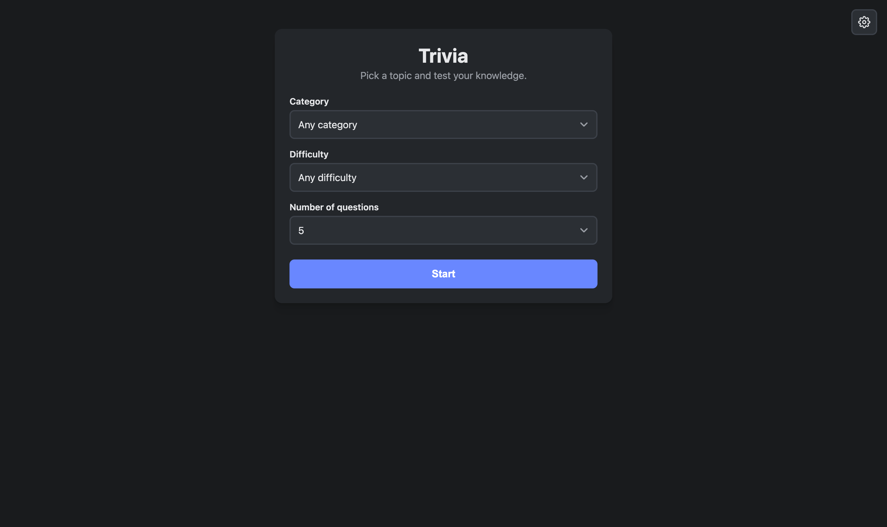
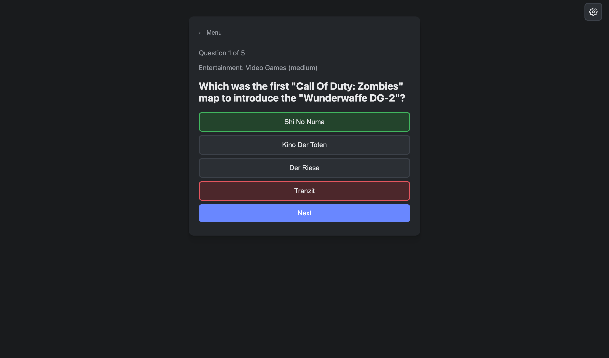
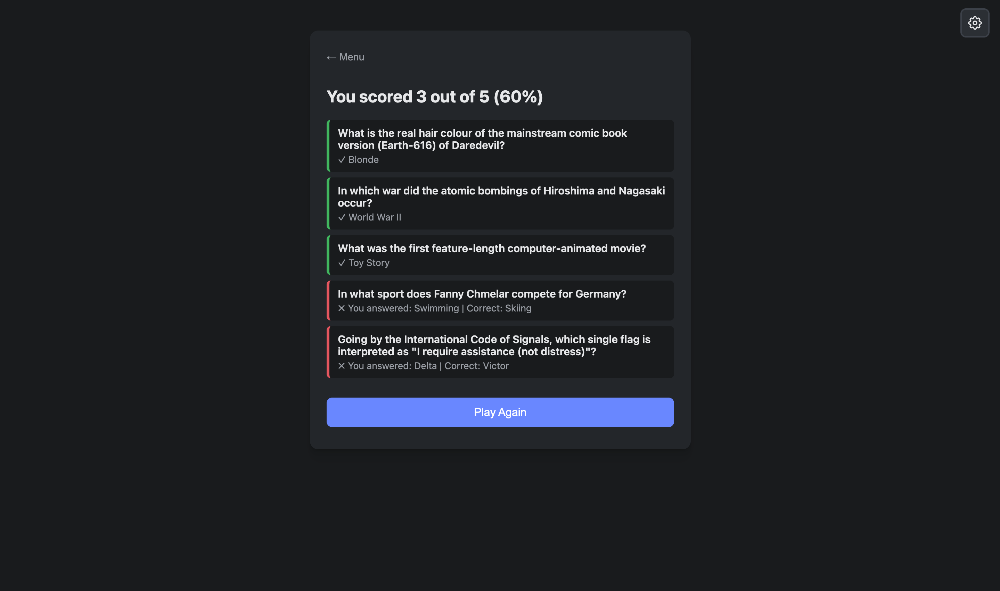
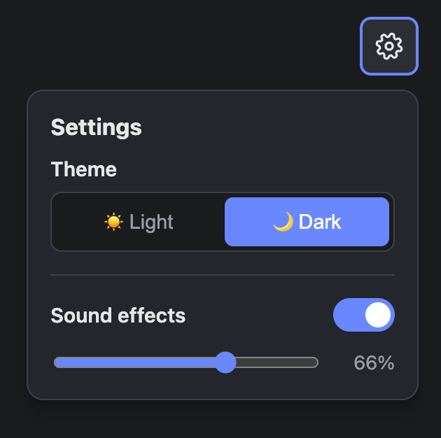

# Trivia App

A fun trivia game with thousands of questions from the Open Trivia Database.
Pick a category, difficulty, and number of questions, then test your knowledge.
Includes light and dark themes, sound effects with volume control, and a results
screen that reviews every question. Built with Flask, HTML, CSS, and JavaScript.

  
  

  
  

## Run it locally
1. Clone the repo
2. Install dependencies: `pip install -r requirements.txt`
3. Start the server: `python app.py`
4. Open http://127.0.0.1:5000

## Credits
Questions provided by [Open Trivia DB](https://opentdb.com/),
licensed under CC BY-SA 4.0.
